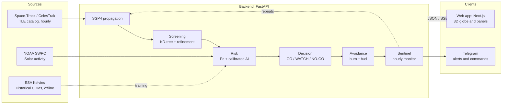

# KesslerWatch

**Space debris collision risk prediction, decision support and avoidance planning.**


KLETECH Hackfest 2026 · Domain 1 · Problem Statement 1C: Space Debris Risk Prediction
Team **The Invariants** · Team 1B.7

---

## Table of Contents

1. [Overview](#overview)
2. [KPIs: Hackfest PS 1C](#kpis-hackfest-ps-1c)
3. [Key Features](#key-features)
4. [Architecture](#architecture)
5. [How It Works](#how-it-works)
6. [AI Model](#ai-model)
7. [Tech Stack](#tech-stack)
8. [Project Structure](#project-structure)
9. [Getting Started](#getting-started)
10. [Configuration](#configuration)
11. [API Reference](#api-reference)
12. [Telegram Bot](#telegram-bot)
13. [Usage Guide](#usage-guide)
14. [Assumptions and Limitations](#assumptions-and-limitations)
15. [Roadmap](#roadmap)
16. [Data Sources](#data-sources)
17. [Team](#team)
18. [License](#license)

---

## Overview

More than 30,000 tracked objects orbit Earth at around 7.5 km/s. Satellite operators receive frequent collision warnings, most of which turn out to be false alarms, and every avoidance manoeuvre costs fuel and mission lifetime.

KesslerWatch helps operators decide which warnings matter and how to respond at the lowest cost. It tracks the full public catalog, screens for close approaches, estimates collision probability with physics and a calibrated machine-learning model, recommends a GO / WATCH / NO-GO decision with reasons, and plans the cheapest safe avoidance burn. A background monitor, Sentinel, repeats this every hour for high-value satellites and alerts operators automatically.

---

## KPIs: Hackfest PS 1C

KesslerWatch is evaluated on the four KPIs defined in the problem statement. All values are measured, stored in `backend/models/metrics.json`, and shown in the app's **Model** tab.

### KPI scorecard

| KPI | Problem statement target | KesslerWatch result | Status |
|---|---|---|---|
| **1. Brier score (calibration)** | Predicted risk should match observed frequency; beat the baseline | **0.0084** vs 0.0298 baseline (held-out); 0.0498 vs 0.0452 (ESA official test) | Met on held-out; close on official test |
| **2. Hit / miss rate** | > 95% recall on high-risk events while reducing false alarms | **96.0% recall** (144 / 150, ESA official test); false alerts **21.3% → 3.1%** with two-stage alerting | Met |
| **3. Lead time** | Flag genuine risks 3–7 days before TCA | **93% recall at ≥ 3 days**, **92% at 5+ days** (ESA official test) | Met |
| **4. Throughput** | Screen the full catalog in minutes, not hours | 1 satellite vs ~32,000 objects: **~33 s**; 42-satellite watchlist: **~74 s**; all-vs-all: ~1.3 h (est.) | Met for monitored satellites |

### KPI 1: Brier score (calibration)

Measures how close predicted probabilities are to what actually happened. Lower is better.

```
Brier = mean( (predicted probability − actual outcome)² )
```

| Model | Held-out (1,779 events, 19 high-risk) | ESA official test (2,167 events, 150 high-risk) |
|---|---|---|
| KesslerWatch live model | **0.0084** | 0.0498 |
| KesslerWatch full model | 0.0078 | 0.0467 |
| Baseline (final risk = latest risk) | 0.0298 | 0.0452 |

Probabilities are calibrated with isotonic regression on a separate validation split. The official test set contains about 7× more high-risk events than the training data, which explains the small gap there.

### KPI 2: Hit / miss rate

- **Recall** = high-risk events caught ÷ all high-risk events
- **False-alert rate** = safe events flagged ÷ all safe events

| Level | Recall | False-alert rate |
|---|---|---|
| Stage 1: AI early flag | **96.0%** | 21.3% |
| Stage 2: WATCH or above (physics-confirmed) | 76.7% | **3.1%** |
| Pc ≥ 10⁻⁵ alone (reference) | 34.0% | 1.1% |
| Baseline (latest risk) | 77% | 3.1% |

*ESA official test set. The AI threshold is chosen on validation data to give ≥ 95% recall.*

Stage 1 keeps nearly every real threat under observation. Stage 2 recommends action only when physics confirms the risk. Alerts must also persist across data updates to reach CONFIRMED GO, and close automatically when risk drops.

### KPI 3: Lead time

Performance when the prediction is made a given number of days before TCA (ESA official test, live model):

| Prediction made | Recall | Brier |
|---|---|---|
| ≥ 2 days before TCA | 96% | 0.050 |
| ≥ 3 days | 93% | 0.055 |
| ≥ 4 days | 93% | 0.053 |
| 5+ days | 92% | 0.050 |

Baseline recall over the same rows: 75–80%. Earlier warning allows smaller burns, because along-track shift ≈ 3 × Δv × time: doubling the warning time halves the burn needed.

### KPI 4: Throughput

Measured on a single CPU core, 72-hour screening window:

| Task | Time |
|---|---|
| One satellite vs full catalog (~32,000 objects) | ~33 s |
| Sentinel watchlist (42 satellites vs full catalog) | ~74 s |
| Full all-vs-all screening | ~1.3 h (estimated, down from ~200 h before KD-tree screening) |

KD-tree neighbour search runs at 60-second steps with propagation shared across all watched satellites, then a 1-second refinement runs only for candidate pairs.

### How KPIs were measured

- **Data:** ESA Kelvins Collision Avoidance Challenge CDMs (2015–2019).
- **Split:** 60 / 20 / 20 train / validation / held-out, **split by event** so no approach appears in both training and testing.
- **Official test:** ESA's own test set, never used for training or tuning.
- **Baseline:** "final risk = latest known risk", the standard reference in the ESA challenge.
- **Throughput:** timed directly in the backend.

---

## Key Features

| Feature | Description |
|---|---|
| **Live globe** | 3D view of about 32,000 tracked objects, coloured by type (payload, rocket body, debris, unknown). |
| **Catalog search** | Look up any object by NORAD ID or name, or paste a custom TLE. Warns when data is older than 30 days. |
| **Conjunction screening** | Finds every close approach for a chosen satellite over the next 72 hours. |
| **Risk assessment** | Collision probability (Pc) from physics, plus a calibrated AI estimate of whether risk will end high. |
| **Decision engine** | GO / WATCH / NO-GO recommendation with plain-language reasons. The operator makes the final call. |
| **False-alert reduction** | Two-stage alerts (AI flags, physics confirms), persistence across updates, and automatic closing when risk drops. |
| **Avoidance planner** | Searches burn direction, size and timing for the smallest safe manoeuvre, and re-screens the new path to avoid creating new conjunctions. |
| **Path visualisation** | Current risky path in red, optimal path in green, with a close-up view at closest approach. |
| **Fuel estimation** | In-orbit: propellant for avoid + return burns and share of tank. Launch: propellant to reach a target orbit from a chosen launch site. |
| **Sentinel** | Hourly automatic screening of 42 high-value satellites (ISS, Tiangong, Hubble and 39 Indian satellites) with live notifications. |
| **Replay mode** | Replays a real historical ESA event through the full pipeline, clearly labelled as historical. |
| **Telegram alerts** | Push notifications for escalated alerts and an interactive command bot. |
| **Re-entry watch** | Estimated decay of low objects, adjusted using NOAA solar activity forecasts. |
| **Model transparency** | All metrics shown in the app are read from measured results, not hard-coded. |

---

## Architecture



The frontend never calls external data sources directly. All data access, computation and model inference run in the backend, which keeps credentials private and heavy computation off the browser.

---

## How It Works

1. **Fetch.** Download the TLE catalog from Space-Track (CelesTrak as fallback) at most once per hour, plus solar activity from NOAA. Data is cached locally.
2. **Propagate.** SGP4 converts each TLE into position and velocity over the next 72 hours, including Earth oblateness (J2), atmospheric drag and lunisolar effects.
3. **Screen.** A KD-tree finds nearby object pairs at 60-second steps, then a 1-second refinement finds the time of closest approach (TCA) and miss distance.
4. **Assess risk.** Pc is computed from miss distance, combined position uncertainty and hard-body radius. The AI model estimates the probability that risk will end above 10⁻⁶.
5. **Decide.** Rules combine Pc, the AI estimate, time to TCA and data age into GO, WATCH or NO-GO, with written reasons.
6. **Plan avoidance.** For manoeuvrable objects only, candidate burns are tested. The smallest burn that brings Pc below 10⁻⁵ without creating a new conjunction is recommended, with its propellant cost.
7. **Monitor and alert.** Sentinel repeats steps 1–6 hourly for the watchlist, tracks each alert's history, and pushes notifications to the web app and Telegram.

### Core equations

| Quantity | Formula |
|---|---|
| Position uncertainty (assumed) | σ = 0.5 km + 1 km × TLE age (days) |
| Combined uncertainty | σc = √(σ₁² + σ₂²) |
| Collision probability (approx.) | Pc ≈ (R² / 2σc²) · exp(−d² / 2σc²) |
| Along-track shift from a burn | Δs ≈ 3 · Δv · t |
| Propellant (rocket equation) | m_prop = m₀ · (1 − e^(−Δv / (Isp · g₀))) |
| Ideal launch Δv to circular orbit | √(μ (2/Rₑ − 1/r)) |

---

## AI Model

**Task.** Given conjunction data available two or more days before TCA, predict whether the final collision risk will be high (Pc ≥ 10⁻⁶) and estimate the final risk value.

**Dataset.** ESA Kelvins Collision Avoidance Challenge: real, anonymised Conjunction Data Messages (CDMs) from ESA missions, 2015–2019. Each close approach (event) contains a sequence of CDMs issued over several days.

**Method.**
- **Models:** gradient-boosted decision trees (scikit-learn HistGradientBoosting): a classifier for high-risk probability and a regressor for final risk.
- **Features:** miss distance, radial / in-track / cross-track separation, position uncertainty, time to TCA, current risk, and trend features across successive CDMs.
- **Split:** 60 / 20 / 20 train / validation / held-out, split by event to prevent leakage.
- **Calibration:** isotonic calibration on the validation split.
- **Threshold:** chosen on validation for at least 95% recall on high-risk events.
- **Class imbalance:** balanced class weights were tested and kept only if they improved validation calibration.
- **Variants:** a *full* model using all ESA fields, and a *live* model using only features computable from public TLEs, which scores real-time approaches in the app.
- **Benchmarks:** compared against a baseline ("final risk = latest known risk") and an LSTM trained on the same split.

The model is trained from scratch on a standard CPU in minutes. No pretrained model is used.

---

## Tech Stack

| Layer | Technology | Purpose |
|---|---|---|
| Backend | Python 3.11, FastAPI, Uvicorn | API server and background jobs |
| Orbital mechanics | sgp4, NumPy, SciPy | Propagation, screening, Pc, numerical integration |
| Machine learning | scikit-learn, pandas, PyTorch (benchmark) | Risk model training and evaluation |
| Storage | SQLite | Sentinel alert history |
| Frontend | Next.js, React, TypeScript, Tailwind CSS | Web application |
| 3D rendering | Three.js, React Three Fiber, satellite.js (Web Worker) | Real-time globe with ~32,000 objects |
| Notifications | Server-Sent Events, Telegram Bot API | Live alerts |

---

## Project Structure

```
├── backend/
│   ├── main.py              # FastAPI app, endpoints, startup and background jobs
│   ├── orbit.py             # Catalog download, TLE parsing, SGP4, screening
│   ├── risk.py              # Uncertainty model and collision probability
│   ├── ml.py                # Model training, evaluation and metrics
│   ├── decision.py          # GO / WATCH / NO-GO rules and explanations
│   ├── maneuver_opt.py      # Avoidance burn search and fuel estimation
│   ├── sentinel.py          # Hourly monitor, alert lifecycle, notifications
│   ├── watchlist.py         # Monitored satellites and priority tiers
│   ├── telegram_bot.py      # Interactive Telegram command bot
│   ├── models/              # Trained models and metrics.json
│   ├── requirements.txt
│   ├── requirements-train.txt
│   └── .env.example         # Environment variable template
└── frontend/
    ├── app/                 # Next.js pages and layout
    ├── components/          # Globe, panels, HUD
    └── public/              # Static assets
```

---

## Getting Started

### Prerequisites
- Python 3.11
- Node.js 18 or later
- A free [Space-Track.org](https://www.space-track.org) account (optional; CelesTrak is used as fallback)

### Backend

```powershell
cd backend
py -3.11 -m pip install -r requirements.txt
copy .env.example .env
py -3.11 -m uvicorn main:app --reload --port 8000
```

Wait for `Application startup complete`. Interactive API docs: `http://localhost:8000/docs`.

### Frontend

```powershell
cd frontend
npm install
npm run dev
```

Open `http://localhost:3000`.

### Training the model (optional)

1. Download the ESA Kelvins dataset from [Zenodo](https://zenodo.org/records/4463683).
2. Extract it to `backend/data/kelvins/`.
3. Run:

```powershell
cd backend
py -3.11 -m pip install -r requirements-train.txt
py -3.11 ml.py
```

---

## Configuration

Create `backend/.env` from `backend/.env.example`.

| Variable | Required | Purpose |
|---|---|---|
| `SPACETRACK_USER` | Recommended | Space-Track login for the full catalog |
| `SPACETRACK_PASS` | Recommended | Space-Track password |
| `N2YO_API_KEY` | Optional | Cross-check for visible passes |
| `TELEGRAM_BOT_TOKEN` | Optional | Telegram bot token from BotFather |
| `TELEGRAM_CHAT_ID` | Optional | Chat that receives Sentinel alerts |
| `TELEGRAM_BOT_DISABLED` | Optional | Set to `1` to disable the command bot |

`.env` is excluded by `.gitignore` and must never be committed.

---

## API Reference

| Endpoint | Purpose |
|---|---|
| `/catalog` | All tracked objects with TLEs and object types |
| `/object/{norad}` | Details for a single object |
| `/screen` | Close approaches with Pc, AI estimate, decision and reasons |
| `/avoid` | Recommended avoidance burn, alternatives and propellant cost |
| `/decision/rules` | Current decision thresholds |
| `/reentry` | Objects with estimated imminent re-entry |
| `/spaceweather` | Current solar activity and 27-day outlook |
| `/sentinel/stream` | Live alert stream (Server-Sent Events) |

Full interactive documentation: `http://localhost:8000/docs`.

---

## Telegram Bot

Sentinel sends a Telegram message when an alert escalates to WATCH or CONFIRMED GO, with the objects involved, TCA, miss distance, Pc, decision and recommended Δv.

| Command | Response |
|---|---|
| `/help` | Command list and guide |
| `/risk` | Current highest-risk conjunctions |
| `/reentry` | Objects with imminent estimated re-entry |
| `/burn` | Recommended avoidance manoeuvres and propellant |
| `/iss` | ISS status and close approaches |
| `/ai` | Model performance metrics |

**Setup:** create a bot with [@BotFather](https://t.me/BotFather), add the token and chat ID to `backend/.env`, then restart the backend.

---

## Usage Guide

1. Open **Live** and search for a satellite, for example `25544` (ISS).
2. Open **Screening** to list close approaches over the next 72 hours.
3. Select an alert to view the decision, reasons, Pc and AI estimate.
4. Review **Avoidance** for the recommended burn, alternatives, fuel cost and red / green paths.
5. Open **Sentinel** for automatically monitored satellites and live alerts. Use **Replay** for a historical demonstration.
6. Use **Fuel** to estimate launch propellant for a site and orbit.
7. Check **Model** for measured performance and **About** for sources and limitations.

---

## Assumptions and Limitations

- Public TLEs give positions accurate to roughly 1 km to a few km. KesslerWatch reports risk above thresholds and never predicts a certain collision.
- Public TLEs carry no covariance, so position uncertainty is an assumed model, labelled as such.
- Objects smaller than about 10 cm are not publicly tracked and are not included.
- The risk model is trained on anonymised ESA data from 2015–2019. Live operator CDMs are not publicly available.
- On the ESA official test set, model calibration is slightly worse than the baseline, reflecting a higher share of high-risk events than in training.
- Re-entry estimates are heuristic and labelled as estimates.
- Burns are modelled as impulsive. Return-to-orbit cost is approximated as equal to the avoidance burn.
- Launch fuel estimates are first-order and use editable assumptions.
- All recommendations are advisory. No manoeuvre is executed automatically.

---

## Roadmap

- Ingest operator CDMs with full covariance
- Official re-entry predictions (TIP messages) alongside estimates
- GPU-accelerated all-vs-all screening
- Self-learning loop that retrains on completed Sentinel alerts
- Manoeuvre and break-up detection from TLE history
- Operator API and email / SMS alerts
- Cloud deployment

---

## Data Sources

| Source | Use |
|---|---|
| [Space-Track.org](https://www.space-track.org) | Full public catalog, object types and sizes |
| [CelesTrak](https://celestrak.org) | Catalog fallback and active satellite list |
| [NOAA Space Weather Prediction Center](https://www.swpc.noaa.gov) | Solar flux (F10.7), Kp index, 27-day outlook |
| [ESA Kelvins Collision Avoidance Challenge](https://kelvins.esa.int/collision-avoidance-challenge/) | Training and evaluation data ([dataset](https://zenodo.org/records/4463683)) |
| [N2YO](https://www.n2yo.com) | Optional pass cross-check |

---

## Team

**The Invariants**, KLE Technological University, Hubballi

- Ayesha Siddiqa V
- Atharv Adake
- Sameer Kulkarni
- Mithesh Mahale
- Rohan Chivate

Built for KLETECH Hackfest 2026 · Domain 1 · PS 1C.

---

## License

Released under the MIT License.
