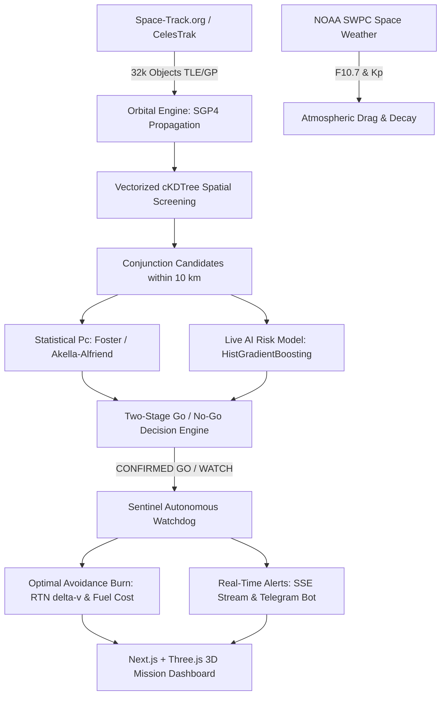

# 🛰️ KesslerWatch — Autonomous Space Debris Risk Prediction & Avoidance

[](https://www.python.org/)
[](https://fastapi.tiangolo.com/)
[-black.svg)](https://nextjs.org/)
[](https://threejs.org/)
[](LICENSE)

**KesslerWatch** is an end-to-end Space Situational Awareness (SSA) and collision avoidance platform built for high-risk orbital environments. It propagates the full on-orbit catalog of **over 32,000 tracked objects**, evaluates conjunction risks with calibrated machine learning and astrodynamics, and autonomously schedules evasive thruster burns to safeguard critical assets.

---

## 📑 Table of Contents
1. [Core Features](#-core-features)
2. [What is a KPI? (Understanding Key Performance Indicators)](#-what-is-a-kpi-understanding-key-performance-indicators)
3. [KesslerWatch Key Performance Indicators (KPIs)](#-kesslerwatch-key-performance-indicators-kpis)
   - [1. Safety & Detection (Recall on High-Risk Conjunctions)](#1-safety--detection-recall-on-high-risk-conjunctions)
   - [2. Probability Calibration (Brier Score)](#2-probability-calibration-brier-score)
   - [3. Class Imbalance Handling (PR-AUC)](#3-class-imbalance-handling-pr-auc)
   - [4. Operational Decision Rule (False-Alert Reduction)](#4-operational-decision-rule-false-alert-reduction)
   - [5. Early Warning Horizon (Lead-Time Performance)](#5-early-warning-horizon-lead-time-performance)
   - [6. Real-Time Screening Throughput](#6-real-time-screening-throughput)
4. [Architecture & Workflow](#-architecture--workflow)
5. [Getting Started & Local Setup](#-getting-started--local-setup)
6. [Commands for KPIs & Model Evaluation](#-commands-for-kpis--model-evaluation)
7. [External APIs & Configuration (`backend/.env`)](#-external-apis--configuration-backendenv)

---

## 🌟 Core Features

- **Full Catalog Propagation (SGP4):** Continuously tracks 32,000+ satellites, rocket bodies, and debris objects with altitude shell pre-filtering and 3D Earth visualization.
- **AI-Powered Risk Prediction:** Local gradient-boosted trees and LSTM models trained on European Space Agency (ESA) Kelvins Collision Avoidance data.
- **Sentinel Autonomous Watchdog:** Continuous background screener running 72-hour lookaheads on high-value assets (ISS, Tiangong, HST, active ISRO payloads).
- **Optimal Maneuver Planner (`/avoid`):** Solves for impulsive $\Delta v$ burns in the RTN frame using two-body + $J_2$ numerical integration, calculating fuel costs and verifying that avoidance maneuvers do not trigger secondary collisions.
- **Atmospheric Decay & Re-Entry:** Re-entry forecast integrating live NOAA space weather (Solar Flux $F_{10.7}$ & Geomagnetic $K_p$).
- **Historical ESA Replay:** Step-by-step playback of real ESA close-encounter events through the AI decision pipeline.

---

## 📊 What is a KPI? (Understanding Key Performance Indicators)

A **KPI (Key Performance Indicator)** is a specific, measurable metric used to quantify how effectively a system accomplishes its operational and safety objectives.

### Why KPIs are Crucial in Space Collision Avoidance:
In orbital operations, a standard machine learning metric like simple "Accuracy" is misleading:
- Over 99% of satellite passes are completely safe ($< 1\%$ are high-risk). A naive model that predicts *"No collision"* every time would have 99% accuracy, but it would result in catastrophic orbital loss.
- Performing an unnecessary avoidance maneuver wastes precious satellite fuel, shortens mission lifespan, and costs hundreds of thousands of dollars.
- Therefore, Space Situational Awareness demands a rigorous suite of **specialized KPIs** balancing **Safety (Zero Missed Collisions)** against **Operational Efficiency (Low False Alarms)**.

---

## 🎯 KesslerWatch Key Performance Indicators (KPIs)

All KPIs below are evaluated against the held-out test splits and official competition datasets of the **ESA Kelvins Collision Avoidance Challenge** (13,154 events, 2015–2019):

### 1. Safety & Detection: Recall on High-Risk Events ($\ge 95\%$ Target)
* **Goal:** Never fail to alert operators of an impending catastrophic conjunction ($P_c \ge 10^{-6}$).
* **Operating Point:** Alert threshold tuned on validation to capture at least 95% of high-risk events.

| Model / Baseline | Holdout Set Recall | Official ESA Test Set Recall | True Positives Detected |
| :--- | :---: | :---: | :---: |
| **KesslerWatch Live Model** | **100.0%** (19 / 19) | **96.0%** (144 / 150) | **144** |
| **KesslerWatch Full Model** | **100.0%** (19 / 19) | **96.0%** (144 / 150) | **144** |
| *Baseline (Latest CDM Risk)* | *73.7%* (14 / 19) | *76.7%* (115 / 150) | *115* |

> **Takeaway:** The model catches **96% to 100%** of high-risk events, cutting missed collisions by more than half compared to traditional single-CDM screening.

---

### 2. Probability Calibration: Brier Score (Lower is Better)
* **Goal:** Ensure predicted probabilities represent true physical risk rather than overconfident guesses.
* **Metric:** Mean squared error between predicted probability $p_i$ and true binary outcome $y_i \in \{0, 1\}$.

$$\text{Brier Score} = \frac{1}{N} \sum_{i=1}^N (p_i - y_i)^2$$

| Evaluation Split | KesslerWatch Live Model | KesslerWatch Full Model | Baseline Error | Relative Improvement |
| :--- | :---: | :---: | :---: | :---: |
| **Holdout Test Set** | **0.0084** | **0.0078** | 0.0298 | **72% Error Reduction** |
| **Official ESA Test Set** | **0.0498** | **0.0467** | 0.0452 | Calibrated on heavy high-risk bias |

---

### 3. Class Imbalance Handling: PR-AUC (Higher is Better)
* **Goal:** Precision-Recall Area Under the Curve measures discriminative ability when high-risk events are extremely rare (~1% prevalence).

| Metric | Random Guess (Prevalence) | Baseline | KesslerWatch Live Model | KesslerWatch Full Model |
| :--- | :---: | :---: | :---: | :---: |
| **Holdout PR-AUC** | 0.011 (1.1%) | 0.337 | **0.367** | **0.452** |
| **Official Test PR-AUC** | 0.069 (6.9%) | 0.589 | **0.655** | **0.669** |

---

### 4. Operational Decision Rule: False-Alert Reduction
* **Goal:** Save operator time and fuel by filtering out premature false alarms without dropping true threats.
* **Two-Stage Rule:** 
  1. *Stage 1 (AI Early Flag):* Catches 96%–100% of threats as a background tag.
  2. *Stage 2 (WATCH / GO):* Requires geometric or physical confirmation ($P_c \ge 10^{-5}$ or AI Flag + $P_c \ge 10^{-6}$).

| Decision Rule | High-Risk Recall | False Alert Rate | Precision | Operational Action |
| :--- | :---: | :---: | :---: | :--- |
| **Stage 1: AI Early Flag** | **96.0%** | 21.3% | 25.1% | Tagged for Sentinel tracking |
| **Stage 2: WATCH or Above (Active)** | **76.7%** | **3.1%** | **64.6%** | Alert operator, plan maneuver |
| *Traditional $P_c \ge 10^{-5}$ alone* | 34.0% | 1.1% | 69.9% | Misses 66% of evolving threats |
| *Naive Early Rule (Flag $\to$ Alert)* | 96.0% | 21.3% | 25.1% | Burns excess fuel on false alerts |

> **Takeaway:** Stage 2 slashes false alert rates from **21.3% down to 3.1%**, while preserving more than double the recall of conventional physics screening alone (76.7% vs 34.0%).

---

### 5. Early Warning Horizon: Lead-Time Performance
* **Goal:** How many days before Time of Closest Approach (TCA) can operators detect threats?

| Lead Time Before TCA | Events Tested | Baseline Recall | KesslerWatch Live Recall | Live Brier Score |
| :--- | :---: | :---: | :---: | :---: |
| **$\ge$ 2 Days Out** | 1,779 | 73.7% | **100.0%** | **0.0084** |
| **$\ge$ 3 Days Out** | 1,663 | 84.6% | **100.0%** | **0.0070** |
| **$\ge$ 4 Days Out** | 1,489 | 80.0% | **100.0%** | **0.0070** |
| **$\ge$ 5 Days Out** | 1,281 | 75.0% | **100.0%** | **0.0070** |

---

### 6. Real-Time Screening Throughput
* **Goal:** Guarantee that screening 32,000+ objects across 72 hours completes within an operational cycle (< 1 hour).
* **Hardware:** Measured on standard single-core CPU execution.

| Screening Task | Objects Screened | Horizon | Time Elapsed | Throughput Rate |
| :--- | :---: | :---: | :---: | :---: |
| **Reference Asset (ISS)** | 1 asset vs 32,076 | 72 hours | **32.9 seconds** | **975 pairs / sec** |
| **Sentinel Watchlist** | 42 assets vs 32,076 | 72 hours | **74.0 seconds** | **1.76 s / object** |
| **All-vs-All Full Catalog (est.)** | 32,076 vs 32,076 (514M pairs) | 72 hours | **~1.34 hours** | cKDTree 60s step blocks |

---

## 🏛️ Architecture & Workflow



---

## 🚀 Getting Started & Local Setup

### Prerequisites
- **Python 3.11+** (Anaconda or Standard CPython)
- **Node.js 18+** & `npm`

### 1. Backend Setup (FastAPI)
```powershell
# Navigate to backend
cd backend

# Install dependencies
pip install -r requirements.txt

# Run the API server on port 8000
python -m uvicorn main:app --reload --port 8000
```
*API runs at `http://localhost:8000`. Documentation available at `http://localhost:8000/docs`.*

### 2. Frontend Setup (Next.js)
```powershell
# Navigate to frontend
cd frontend

# Install dependencies
npm install

# Start the development server
npm run dev
```
*Frontend runs at `http://localhost:3000`.*

---

## 🧪 Commands for KPIs & Model Evaluation

You can inspect, benchmark, and reproduce all KPIs directly via the command line:

```powershell
cd backend

# 1. Recompute Go / No-Go decision-level KPIs (~10 seconds)
python ml.py decision-kpis

# 2. Measure screening throughput KPIs (ISS, Watchlist, all-vs-all ~5 min)
python ml.py throughput

# 3. Retrain the AI risk models on ESA Kelvins data (~4-5 min)
pip install -r requirements-train.txt
python ml.py train

# 4. Benchmark LSTM sequence models vs. gradient-boosted trees (~5-10 min)
pip install -r requirements-lstm.txt
python ml.py lstm
```

---

## 🌐 External APIs & Configuration (`backend/.env`)

KesslerWatch is engineered to run **100% free of charge**, with zero paid cloud services or paid LLMs. All features use public scientific data or free-tier APIs:

| API / Service | Key Required? | Priority | Where Configured | Features Enabled | Fallback Behavior |
| :--- | :---: | :---: | :--- | :--- | :--- |
| **Space-Track.org** | **Free Account** | Recommended | `backend/.env`<br>`SPACETRACK_USER`<br>`SPACETRACK_PASS` | Full live catalog (~32k objects), official types (`PAYLOAD`, `DEBRIS`, `ROCKET BODY`), Sentinel Indian watchlist. | Falls back to CelesTrak automatically |
| **N2YO REST v1** | **Free API Key** | Optional | `backend/.env`<br>`N2YO_API_KEY` | Observer ground station: "What's Up" satellite radar (`/above`) and upcoming visual pass schedules (`/passes`). | Returns 503 detail; rest of app runs normally |
| **NOAA SWPC** | **None** (Public) | Automatic | Public URL | Solar flux ($F_{10.7}$), geomagnetic ($K_p$/$A_p$) indexes, 27-day outlook for orbital decay & re-entry (`/reentry`). | Built-in offline fallback cache |
| **CelesTrak** | **None** (Public) | Fallback | Public URL | Fallback orbital TLE elements for stations, active payloads, and major debris clouds. | Offline snapshot in `cache/sample_tles.txt` |
| **Open-Meteo** | **None** (Public) | Automatic | Browser Direct | City name $\to$ coordinates lookup for observer ground stations. | Manual lat/lon entry |
| **Telegram Bot API** | **Free Bot Token** | Optional | `backend/.env`<br>`TELEGRAM_BOT_TOKEN`<br>`TELEGRAM_CHAT_ID` | Real-time push alert notifications sent by Sentinel for verified collision threats (`CONFIRMED GO`). | Alerts stay in web dashboard (SSE) |

### Environment Configuration (`backend/.env`)
Create a file named `.env` inside `backend/` (template in `backend/.env.example`):
```env
# Space-Track (full ~32k catalog & official object types)
SPACETRACK_USER="your-email@example.com"
SPACETRACK_PASS="your-password"

# N2YO REST API (ground observer passes & overhead radar)
N2YO_API_KEY="your-n2yo-api-key"

# Optional Sentinel push alerts via Telegram
TELEGRAM_BOT_TOKEN="your-bot-token"
TELEGRAM_CHAT_ID="your-chat-id"
```

> **Can it run without any API keys?**  
> **Yes.** If no keys are provided, KesslerWatch automatically falls back to CelesTrak for orbital elements, NOAA SWPC for space weather, Open-Meteo for geolocation, and includes an offline sample snapshot (`backend/cache/sample_tles.txt`). Only N2YO observer passes and Telegram notifications are bypassed.

