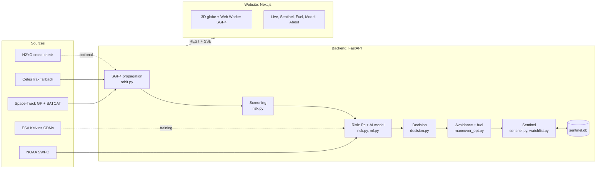

# KesslerWatch

Space debris risk prediction: screens satellites against the full on-orbit catalog, estimates collision probability with physics and an AI model trained on ESA data, and recommends the cheapest safe avoidance burn.

Built in 24 hours as a hackathon prototype. It is a decision-support demo, not an operational system: every recommendation is for an operator to review, and nothing is ever executed.

## Screenshots

| | |
|---|---|
|  |  |
|  |  |
|  |  |
|  |  |

## Features

**Live globe and catalog**
- The full on-orbit catalog (about 32,000 objects from Space-Track, with official object types: payload, rocket body, debris, unknown) on a 3D Earth, propagated with SGP4 in a Web Worker and drawn as a single instanced point field.
- Time dock with 1x / 10x / 100x / 1000x playback, pause and "now". The Earth rotates by sidereal time; day and night follow the real sun direction.
- Search by name or NORAD ID; click an object to fly to it and see its orbit and details.
- "Overhead now" and visible passes for an observer (default Hubballi, Karnataka; browser location or city search), computed locally with SGP4.
- 29 verified orbital launch sites as globe pins with info cards, search and filters.

**Screening**
- Screens a selected satellite against the whole catalog for up to 72 hours: a vectorized 60 s pass with a k-d tree per step, then 1 s refinement around each close approach.
- Reports time of closest approach (TCA), miss distance, radial / in-track / cross-track components, relative velocity and TLE ages.

**Pc and AI risk**
- Physics collision probability (Pc) from the miss distance, an assumed position uncertainty and a 20 m hard-body radius.
- AI risk (model est.): the probability that the event ends high-risk, and its estimated final risk, from a model trained on ESA conjunction data messages. Per-input contributions are shown.

**GO / WATCH / NO-GO with reasons**
- Each conjunction gets a recommendation (GO: manoeuvre, WATCH: re-assess, MONITOR: cannot manoeuvre, NO-GO: hold) and a plain-language explanation. The rules and thresholds are served by `GET /decision/rules`.

**Two-stage alerts and false-alert checks**
- Stage 1, AI early flag: the AI model flags an event at a threshold that caught at least 95% of high-risk events in validation. This is a tag only and never raises an alert by itself.
- Stage 2, physics: WATCH needs Pc ≥ 1e-5, or the AI flag together with Pc ≥ 1e-6, or a TLE older than 3 days on an approach closer than 5 km. GO needs Pc ≥ 1e-4 or AI final risk ≥ 1e-4, plus a valid avoidance option.
- Sentinel's guard confirms a GO only after two consecutive data updates above the GO threshold (or Pc and AI final risk both at GO level), caps stale data at WATCH, and resolves alerts when new data lowers the risk or TCA passes.

**Avoidance planner**
- Searches burns along ±along-track, ±radial and ±cross-track, 25 sizes from 0.005 to 2 m/s, at 0.5 / 1 / 2 / 3 orbits before TCA. The burn's effect is integrated with two-body + J2 and added to the SGP4 orbit.
- Recommends the cheapest burn that brings Pc below the target (default 1e-5) and gives a decision deadline.
- No-new-collision check: the cheapest options are re-screened against the full catalog up to 24 h after TCA and rejected if they create a new close approach.
- On the globe: the current path in rose (dashed), the planned path in green, the other object in grey, with burn and closest-approach markers. A true-scale "Close-up at TCA" inset shows the uncertainty circle, the old and new miss distances and a km scale bar.

**Fuel**
- In orbit: propellant for the avoidance burn and an estimated return burn, the share of the tank, the cost in days of station-keeping life, the top five options by efficiency, and how Δv grows as the burn is left later.
- Launch to orbit: Δv budget (ideal, losses, Earth-rotation bonus or penalty), multi-stage propellant and lift-off mass, a propellant-vs-altitude sweep, and a ranking of all 29 launch sites for the same orbit and for a due-east launch.

**Sentinel**
- Runs hourly with the API. Screens a watchlist of 42 satellites (ISS and Tiangong as crewed, Hubble as critical, and 39 active Indian LEO payloads) against the full catalog for the next 72 hours, scores every conjunction, attaches an avoidance plan and fuel cost to WATCH / GO alerts, and keeps history in SQLite.
- Notifications: in-page toast and chime, browser notifications, a server-sent event stream, and optional Telegram messages.
- Replay mode plays a real ESA historical event CDM by CDM, clearly labelled as a replay.

**Re-entry watch and space weather**
- Objects with perigee below 400 km, ranked by a decay heuristic scaled by NOAA's 27-day F10.7 solar flux outlook (est.).
- Current F10.7, Kp and Ap from NOAA SWPC.

**Model tab**
- Brier score, calibration chart, held-out and official-test metrics with bootstrap intervals, trees vs LSTM vs baseline, decision-level KPIs, screening throughput and the training data source, all read from `backend/models/metrics.json`.

## Architecture



### Backend files

| File | What it does |
|---|---|
| `backend/main.py` | FastAPI app: every endpoint, caching, CORS / gzip, starts Sentinel in the app lifespan. |
| `backend/orbit.py` | Catalog sources (Space-Track primary, CelesTrak fallback, offline snapshot), rate limiting and caches, N2YO client, NOAA space weather, local "overhead now" and pass prediction. |
| `backend/risk.py` | Conjunction screening (SatrecArray + cKDTree coarse pass, 1 s refinement), assumed σ, Pc, legacy along-track manoeuvre estimate, re-entry heuristic. |
| `backend/ml.py` | AI risk model: training on ESA Kelvins data, live scoring, KPIs, LSTM benchmark, throughput measurement (`train`, `lstm`, `throughput`, `decision-kpis`). |
| `backend/decision.py` | Two-stage GO / WATCH / MONITOR / NO-GO rules and plain-language explanations. |
| `backend/maneuver_opt.py` | Avoidance planner: burn grid, two-body + J2 burn effect, no-new-collision check, fuel (Tsiolkovsky), lead-time curve. |
| `backend/sentinel.py` | Hourly monitor, false-alert guard, SQLite persistence, SSE and Telegram notifications, ESA replay. |
| `backend/watchlist.py` | Sentinel watchlist: verified defaults plus the Indian payload sync from SATCAT. |
| `backend/launch_fuel.py` | Launch-to-orbit Δv budget, staging and site comparison. |
| `backend/test_launch_fuel.py` | Sanity tests for `launch_fuel.py`. |
| `backend/data_static/launch_sites.json` | 29 launch sites with sources and coordinate checks. |
| `backend/models/` | Trained models (`full.joblib`, `live.joblib`) and `metrics.json`. |

The frontend lives in `frontend/`: `components/scene/` (globe, object field, orbits, avoidance paths, launch-site pins), `components/hud/` (panels, time dock, encounter inset, fuel breakdown), `components/tabs/` (Sentinel, Fuel, Model, About) and `public/workers/propagate.worker.js` (SGP4 in a Web Worker).

### Main API endpoints

| Endpoint | Purpose |
|---|---|
| `GET /catalog` | Full catalog with object type, TLEs, perigee / apogee, RCS size (gzipped). |
| `GET /status` | Object counts by type, catalog source and freshness. |
| `GET /object/{norad}` | One object by NORAD ID. |
| `GET /above`, `GET /passes/{norad}` | Objects overhead now; visible passes for an observer. |
| `POST /screen` | Conjunctions for one satellite with Pc, AI risk and decision. |
| `POST /avoid` | Avoidance plan: candidates, recommendation, deadline, paths, fuel, lead-time curve. |
| `GET /decision/rules` | Decision thresholds and rules. |
| `GET /reentry` | Re-entry watch list (est.). |
| `GET /spaceweather` | F10.7, Kp, Ap and the 27-day outlook. |
| `GET /launch-sites`, `POST /launch-fuel` | Launch sites; launch-to-orbit propellant and site ranking. |
| `GET /model/metrics`, `GET /metrics`, `GET /about` | Model metrics, run statistics, configured values. |
| `GET /sentinel/status`, `GET /sentinel/alerts[/{id}]` | Sentinel state and alert board. |
| `POST /sentinel/run`, `GET/POST/PATCH/DELETE /sentinel/watchlist` | Run a cycle now; edit the watchlist. |
| `GET /sentinel/stream` | Server-sent events for live updates. |
| `POST/GET/DELETE /sentinel/replay` | ESA historical event replay. |

`POST /maneuver` is a legacy quick estimate kept for reference; the UI uses `/avoid`.

## AI model

**Data.** ESA's Collision Avoidance Challenge (Kelvins) dataset: anonymised Conjunction Data Messages received by ESA's Space Debris Office, 2015–2019. The task follows the challenge: predict the risk (log10 collision probability) in an event's last CDM using only CDMs at least 2 days before TCA. High-risk means final risk ≥ 1e-6.

**Training.**
- Split by event (never by CDM), stratified on high-risk, fixed seed: 60% train (5,334 events, 55 high-risk), 20% validation (1,779, 19), 20% held-out test (1,779, 19). ESA's official test set (2,167 events, 150 high-risk) is used only for reporting.
- Model: gradient-boosted trees (scikit-learn HistGradientBoosting). An isotonic-calibrated classifier for P(high-risk), plus regressors for the change from the latest risk.
- Two versions: **full** (141 inputs from the CDMs) and **live** (8 inputs our screener can actually produce: miss distance, relative speed, time to TCA, log10 Pc, σ, miss / σ, object type, radial separation). The website uses the live model.
- Every choice is made on the validation split: class weighting (balanced weighting was tried; unweighted won on Brier), the radial-separation input (kept), and the alert threshold (the highest probability that still catches ≥ 95% of high-risk validation events: 0.0034 for the live model).

**Baseline.** The challenge's "latest risk" baseline: final risk = the risk of the latest CDM at least 2 days before TCA. Our implementation reproduces the published baseline score (0.693 vs 0.694).

**Trees vs LSTM.** An LSTM over the CDM sequence (PyTorch, CPU) was trained on the same split, target and calibration. It replaces the trees only if its live-input version beats them on validation Brier and PR-AUC. It did not (validation Brier 0.00942 vs 0.00912, PR-AUC 0.201 vs 0.219), so the trees stay live.

### KPIs

All numbers are from `backend/models/metrics.json` (trees trained 2026-10-10). Recall and false-alert rate are at the 95%-recall validation threshold; the baseline uses its own rule (latest risk ≥ 1e-6). Lower is better for Brier and the Kelvins score.

Held-out test (1,779 events, 19 high-risk):

| Model | Brier | ROC-AUC | PR-AUC | Recall | False-alert rate | Kelvins score |
|---|---|---|---|---|---|---|
| Baseline (latest risk) | 0.0298 | 0.976 | 0.337 | 0.737 (14/19) | 2.7% | 0.522 |
| Trees, full | 0.0078 | 0.977 | 0.452 | 1.00 (19/19) | 27.9% | 1.044 |
| Trees, live | 0.0084 | 0.965 | 0.367 | 1.00 (19/19) | 22.5% | 0.966 |

ESA official test (2,167 events, 150 high-risk):

| Model | Brier | ROC-AUC | PR-AUC | Recall | False-alert rate | Kelvins score |
|---|---|---|---|---|---|---|
| Baseline (latest risk) | 0.0452 | 0.944 | 0.665 | 0.767 (115/150) | 3.1% | 0.693 |
| Trees, full | 0.0467 | 0.954 | 0.633 | 0.96 (144/150) | 25.8% | 0.805 |
| Trees, live | 0.0498 | 0.955 | 0.655 | 0.96 (144/150) | 21.3% | 0.691 |

For reference, the published latest-risk baseline scores 0.694 and the challenge winner 0.556 (arXiv:2008.03069).

Trees vs LSTM (same events and thresholds chosen on validation):

| Model | Held-out Brier | Held-out PR-AUC | Held-out recall | Official Brier | Official PR-AUC | Official recall |
|---|---|---|---|---|---|---|
| Trees, full | 0.0078 | 0.452 | 1.00 | 0.0467 | 0.633 | 0.96 |
| Trees, live | 0.0084 | 0.367 | 1.00 | 0.0498 | 0.655 | 0.96 |
| LSTM, full | 0.0091 | 0.271 | 0.79 | 0.0571 | 0.521 | 0.87 |
| LSTM, live | 0.0098 | 0.165 | 1.00 | 0.0568 | 0.587 | 0.95 |

Decision levels on the ESA official test (Pc from the latest CDM ≥ 2 days out; truth = final risk ≥ 1e-6):

| Level | Recall | False-alert rate | Precision | Alerts |
|---|---|---|---|---|
| AI early flag (tag only) | 0.96 | 21.3% | 25.1% | 574 |
| WATCH or above (two-stage rule) | 0.767 | 3.1% | 64.6% | 178 |
| Pc ≥ 1e-5 alone (for comparison) | 0.34 | 1.1% | 69.9% | 73 |

What this means, plainly:
- The AI model is better calibrated than the baseline on held-out events (Brier 0.0084 vs 0.0298) and catches every held-out high-risk event, but it raises many more alerts. On the Kelvins score and F2 it does not beat the baseline; on the official test the live model's score (0.691) is not distinguishable from the baseline (0.693).
- That is why the AI is used as an early flag and the physics Pc gates WATCH and GO. The two-stage rule catches more than twice as many high-risk events as Pc alone (77% vs 34% on the official test) at a 3.1% false-alert rate.

Screening throughput (measured 2026-10-10 on 32,076 objects, one CPU core, 72 h horizon): ISS vs the catalog in 32.9 s; the whole 42-satellite watchlist in 74.0 s (484,940 pairs checked). A full all-vs-all screen is estimated at about 1.3 hours (est., scaled from a measured 1 h slice).

## Data sources

| Source | Used for |
|---|---|
| [Space-Track.org](https://www.space-track.org/) (GP and SATCAT classes) | Primary catalog with official object types; Indian payload watchlist. Free account needed. |
| [CelesTrak](https://celestrak.org/NORAD/elements/) | Fallback catalog when Space-Track is not configured or fails (object types inferred from names); "active" group. |
| [NOAA SWPC](https://www.swpc.noaa.gov/) ([F10.7](https://services.swpc.noaa.gov/json/f107_cm_flux.json), [Kp](https://services.swpc.noaa.gov/products/noaa-planetary-k-index.json), [27-day outlook](https://services.swpc.noaa.gov/text/27-day-outlook.txt)) | Space weather and the re-entry scaling. |
| [ESA Kelvins Collision Avoidance Challenge](https://kelvins.esa.int/collision-avoidance-challenge/) ([paper](https://arxiv.org/abs/2008.03069)) | AI model training and evaluation; Sentinel replay. |
| [N2YO](https://www.n2yo.com/api/) | Optional cross-check for overhead objects and passes. |
| [Open-Meteo geocoding](https://open-meteo.com/en/docs/geocoding-api) (GeoNames data) | City search for the observer location, called from the browser. |
| Wikipedia (via the MediaWiki API), [ISRO SDSC](https://www.isro.gov.in/SDSC.html), Queensland Government maritime notices, [OpenStreetMap Nominatim](https://nominatim.openstreetmap.org/) | Launch-site facts and coordinate checks; every site lists its own sources. |

Space-Track rate limits are respected: the full catalog is fetched at most once per hour and cached, with no per-object bulk requests.

## Setup (Windows)

Requirements: Python 3.11 (use the `py -3.11` launcher), Node.js 20 or newer.

**1. Secrets.** Copy the template and fill it in. The app runs without it (CelesTrak fallback, no Telegram), but Space-Track gives the full catalog with official object types.

```powershell
copy backend\.env.example backend\.env
```

| Variable | Needed for |
|---|---|
| `SPACETRACK_USER`, `SPACETRACK_PASS` | Primary catalog and the Indian watchlist |
| `N2YO_API_KEY` | Optional cross-check |
| `TELEGRAM_BOT_TOKEN`, `TELEGRAM_CHAT_ID` | Optional Sentinel notifications |

`backend/.env` is gitignored. Never commit it.

**2. Backend** (http://localhost:8000)

```powershell
cd backend
py -3.11 -m pip install -r requirements.txt
py -3.11 -m uvicorn main:app --reload --port 8000
```

Sentinel starts with the API; set `SENTINEL_DISABLED=1` to turn it off.

**3. Frontend** (http://localhost:3000)

```powershell
cd frontend
npm install
npm run dev
```

The frontend reads `NEXT_PUBLIC_API_URL` (default `http://localhost:8000`).

**Optional**

```powershell
cd backend
py -3.11 -m pip install -r requirements-train.txt
py -3.11 ml.py train          # retrain the AI model (~5 min; needs the Kelvins data in backend/data/kelvins/)
py -3.11 ml.py decision-kpis  # recompute decision-level KPIs (~10 s)
py -3.11 ml.py throughput     # measure screening throughput (~5 min)
py -3.11 test_launch_fuel.py  # launch-fuel sanity tests

py -3.11 -m pip install -r requirements-lstm.txt
py -3.11 ml.py lstm           # LSTM benchmark (~5–10 min, CPU)
```

The Kelvins data is not in the repository; download it from the ESA Kelvins site into `backend/data/kelvins/kelvins_competition_data/`.

## Assumptions and limits

- **No covariance.** TLEs carry no uncertainty. We assume an isotropic position error σ = 0.5 km + 1.0 km per day of TLE age at TCA for each object. Pc depends heavily on this assumption; operational Pc uses CDM covariances, which we do not have.
- **TLE accuracy.** SGP4 with public TLEs is good to about a kilometre and degrades with age. Conjunctions more than 48 h out are marked lower confidence.
- **Hard-body radius** is 20 m by default for every pair.
- **AI model domain.** Trained on ESA CDMs for ESA's own satellites, 2015–2019, with inputs at 2–7 days before TCA. Live inputs come from our TLE screening, not from CDMs, so the live model is an approximation; outside 2–7 days it is marked out of domain. It raises many false alerts by design (≥ 95% recall), which is why it never raises an alert alone.
- **Who can manoeuvre.** Only objects of type PAYLOAD are assumed to manoeuvre. We do not know which payloads are actually active or have propulsion.
- **Burns.** Impulsive burns; the return burn is assumed equal to the avoidance burn and is not simulated. Mass 500 kg, Isp 220 s, tank 10% of mass and 10 m/s per year of station-keeping are assumed unless given. The lead-time curve is a linearised estimate.
- **Re-entry** is a heuristic from the mean-motion derivative scaled by the F10.7 outlook, not a re-entry prediction. Shown as est.
- **Launch fuel** is first order: equal Δv per stage, one Isp, a fixed loss allowance, no dogleg manoeuvres.
- **Throughput.** Screening runs on one CPU core; an all-vs-all screen of the catalog is not run live.
- **Offline snapshot.** `backend/cache/` is gitignored, so a fresh clone has no offline TLE snapshot and needs network access on first start.
- Every estimated or assumed value is labelled "est." or "assumed" in the UI. Recommendations are for an operator to decide; nothing is executed.

## Future scope

- Use real covariances: ingest CDMs (Space-Track CDM class, for operators with access) instead of TLE-age σ.
- Operator data: active status, propulsion, mass and Isp per satellite instead of assumptions.
- Finite-burn modelling and a simulated return-to-orbit burn.
- Retrain the AI model on live screening outputs, and add drag and decay learning for re-entry.
- Faster screening: multi-process or GPU propagation to make all-vs-all screening practical.
- Coordination between two manoeuvrable operators and a shared alert feed.

## Team

**The Invariants**
- Ayesha Siddiqa V
- Atharv Adake
- Sameer Kulkarni
- Mithesh Mahale
- Rohan Chivate

## Licence

No licence has been chosen yet. Add a `LICENSE` file before publishing the repository. Data from Space-Track, CelesTrak, NOAA, ESA and the other sources above remains under each provider's own terms.
