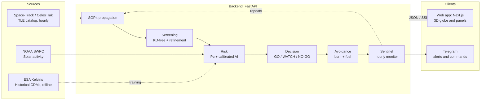

# KesslerWatch

**Space debris collision risk prediction, decision support and avoidance planning.**

KLETECH Hackfest 2026 · Domain 1 · Problem Statement 1C: Space Debris Risk Prediction
Team **The Invariants**

---

## Table of Contents

1. [Overview](#overview)
2. [Key Features](#key-features)
3. [Architecture](#architecture)
4. [How It Works](#how-it-works)
5. [AI Model](#ai-model)
6. [Results](#results)
7. [Tech Stack](#tech-stack)
8. [Project Structure](#project-structure)
9. [Getting Started](#getting-started)
10. [Configuration](#configuration)
11. [API Reference](#api-reference)
12. [Telegram Bot](#telegram-bot)
13. [Usage Guide](#usage-guide)
14. [Assumptions and Limitations](#assumptions-and-limitations)
15. [Roadmap](#roadmap)
16. [Data Sources](#data-sources)
17. [Team](#team)
18. [License](#license)

---

## Overview

More than 30,000 tracked objects orbit Earth at around 7.5 km/s. Satellite operators receive frequent collision warnings, most of which turn out to be false alarms, and every avoidance manoeuvre costs fuel and mission lifetime.

KesslerWatch helps operators decide which warnings matter and how to respond at the lowest cost. It tracks the full public catalog, screens for close approaches, estimates collision probability with physics and a calibrated machine-learning model, recommends a GO / WATCH / NO-GO decision with reasons, and plans the cheapest safe avoidance burn. A background monitor, Sentinel, repeats this every hour for high-value satellites and alerts operators automatically.

---

## Key Features

| Feature | Description |
|---|---|
| **Live globe** | 3D view of about 32,000 tracked objects, coloured by type (payload, rocket body, debris, unknown). |
| **Catalog search** | Look up any object by NORAD ID or name, or paste a custom TLE. Warns when data is older than 30 days. |
| **Conjunction screening** | Finds every close approach for a chosen satellite over the next 72 hours. |
| **Risk assessment** | Collision probability (Pc) from physics, plus a calibrated AI estimate of whether risk will end high. |
| **Decision engine** | GO / WATCH / NO-GO recommendation with plain-language reasons. The operator makes the final call. |
| **False-alert reduction** | Two-stage alerts: the AI flags early, physics confirms. Alerts must persist across updates to escalate and close automatically when risk drops. |
| **Avoidance planner** | Searches burn direction, size and timing for the smallest safe manoeuvre, and re-screens the new path to avoid creating new conjunctions. |
| **Path visualisation** | Current risky path in red, optimal path in green, with a close-up view at closest approach. |
| **Fuel estimation** | In-orbit: propellant for avoid + return burns and share of tank. Launch: propellant to reach a target orbit from a chosen launch site. |
| **Sentinel** | Hourly automatic screening of 42 high-value satellites (ISS, Tiangong, Hubble and 39 Indian satellites) with live notifications. |
| **Replay mode** | Replays a real historical ESA event through the full pipeline for demonstration. Clearly labelled as historical. |
| **Telegram alerts** | Push notifications for escalated alerts and an interactive command bot. |
| **Re-entry watch** | Estimated decay of low objects, adjusted using NOAA solar activity forecasts. |
| **Model transparency** | All metrics shown in the app are read from measured results, not hard-coded. |

---

## Screenshots

| Live globe | Screening and avoidance |
|---|---|
|  |  |

| Sentinel | Fuel |
|---|---|
|  |  |

---

## Architecture

The frontend never calls external data sources directly. All data access, computation and model inference run in the backend, which keeps credentials private and heavy computation off the browser.

---

## How It Works

1. **Fetch.** Download the TLE catalog from Space-Track (CelesTrak as fallback) at most once per hour, and solar activity data from NOAA. Data is cached locally.
2. **Propagate.** SGP4 converts each TLE into position and velocity over the next 72 hours,
